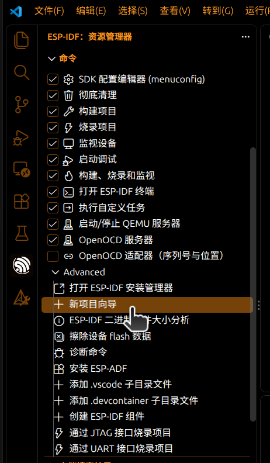
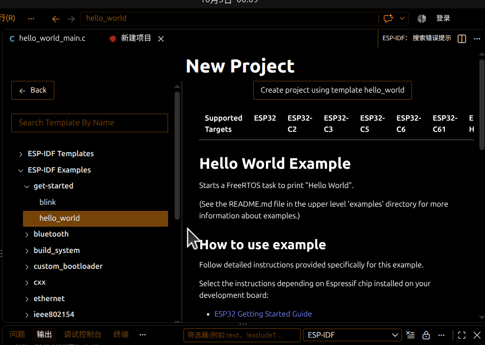
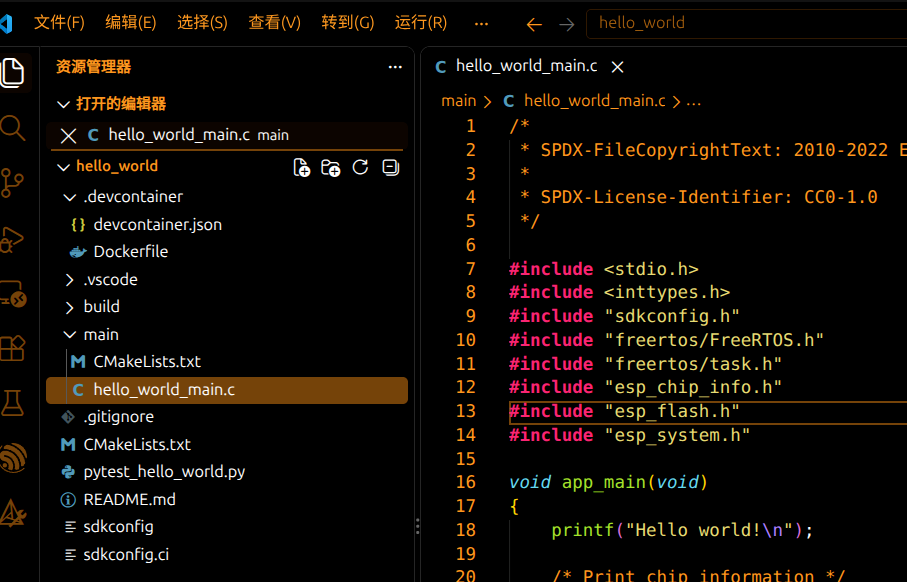

# ESP32项目结构

## 创建ESP32的项目

这里我用到的是ESP32 H2芯片

使用VScode的ESP-IDF插件创建项目，以hellow_world为模板创建项目，如下图所示:

## ESP32项目结构

创建完成项目之后，可以看到ESP32项目的结构如下图所示：

hello_world_main.c就是主要编写业务的文件了，创建的项目本身就是一个RTOS的项目，通过查看其头文件位置，发现RTOS相关的文件、esp芯片信息头文件、esp_flash文件，都位于之前我们安装的IDF环境下；