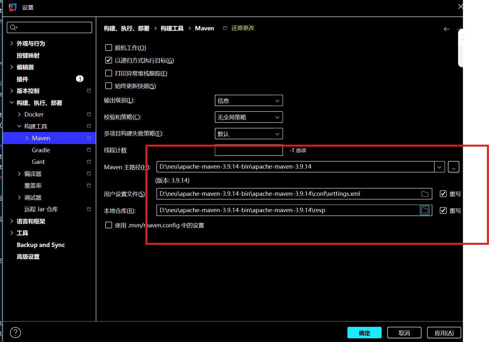

# 1. MVC架构是什么？

MVC架构，从逻辑上把整个程序分成：**视图--分派请求--处理请求** 3个部分，分别对应View--Controller--Model

1. Model层

    又分成Service层和持久化层

    DAO/Mapper层（持久化层）：操作数据库
    Service：业务逻辑/事务控制

2. Controller层
    数据流转/界面切换

3. View层
    前端技术（Vue、React）--> HTML + CSS

Java的SSM（或者说SpringBoot + Mybatis）就是一个实现MVC架构的框架，这套框架减少了程序员所需手动编写的代码量；

## 1.1 View层

用户看到的网页

view层负责收集、展示数据；不负责处理业务逻辑


## 1.2 Controller层

控制层负责拦截URL，把不同的URL请求分配给对应的函数；

当这些函数处理完请求后，再把数据或者结果反馈给View层；

Controller层不会直接操作数据库，也不负责处理复杂的业务逻辑


## 1.3 Model层

Model层负责具体的业务处理，一般还可以再细分为Service层和DAO层(持久化层)

DAO层（持久化）的函数负责操作数据库，在SpringBoot + Mybatis框架中，Mybatis框架替代了手写的DAO层，其提供了一种代码量更少的数据库操作方法；

Service层中的函数则会组合多个DAO层的函数构成“事务”

```shell
# 举个例子
# Service层里，有一个“转账”事务，在代码中就表现为，Service层里有一个转账函数
# 转账事务需要进行两个SQL操作：A给B转，涉及到A账号扣钱，B账号加钱
# 	扣钱的SQL操作在DAO中对应一个函数
# 	加钱的SQL操作在DAO中也对应一个函数
# 则转账这个Service层函数，要调用两个DAO层的SQL操作函数，并且保证这两个SQL要么都执行成功，如果有一个
# 执行失败，成功的那个也要回滚
```


## 1.4 MVC框架里的数据流向

### 1.4.1  View-->Controller  RESTful风格

前端通过HTTP请求，向后端发送消息，HTTP请求的报文结构如下：

```http
POST /students/1?name=zhangsan HTTP/1.1     ← 请求行（含 URL 的路径+查询）
Host: api.example.com                        ← 请求头
Content-Type: application/json
{"sname":"张三"}                              ← 请求体
```

报文中会标明，用什么类型的请求（post get put delete）去哪里进行操作（url）

前端如果想要携带一些参数给后端，有以下几种方法：

##### 1 通过URL携带参数

这种方式所有类型的请求（GET POST PUT DELETE）都可以使用

```http
http://localhost:8080/info.do?account=123&passwd=456
```

服务端通过account和passwd形参获取参数值

```java
@RestController
public class Test2Controller {
	@GetMapping("/submitData.do")
	public String getData1(String account, String password){
		return "OK:"+account+":"+password;
	}
}
```

从上述的URL不难发现，GET类型的URL会把参数放在URL中以明文形式递交给后端，因此要避免使用GET提交敏感数据（比如密码），此外，URL有长度限制，因此也不能使用get方法提交文件（文件太大的话会超出URL长度限制）

##### 2 通过Form URL encoded携带参数

前端：利用报文体（body）传递数据

服务端：直接在方法上设置同名参数  （少用）

##### 3 通过Multpart Form

前端：利用报文体(body)传递数据，允许上传文件

服务端：直接在方法上设置同名参数（文件需要另外处理）

##### 4 通过JSON （常用）

前端：通过JSON提交数据，利用报文体（body）

服务端：需要通过一个对象或者Map集合接受数据对象或map需要通过注解@RequestBody修饰

```java
// 声明一个VO
// VO 映射视图层（View）的数据对象
@Setter
@Getter
@AllArgsConstructor
@NoArgsConstructor
public class LoginVO {
	private String account;
	private String password;
}

// 通过LoginVO对象 或 通过Map集合
// 均可以获取json中的内容
@RestController
public class Test2Controller {
	@PutMapping("/submitData.do")
	public String getData3(@RequestBody LoginVO vo){
		return vo+":"+vo.getAccount()+":"+vo.getPassword();
	}
    
	@DeleteMapping("/submitData.do")
	public String getData4(@RequestBody Map<String, Object> map){
		return map+":"+map.get("account")+":"+map.get("password");
	}
}
```

##### 5 URL参数化（常用）

前端：将参数作为URL的一部分

服务端：通过注解@PathVariable绑定URL参数部分

这样做的好处是，可以实现动态的请求

```java
@RestController
public class Test2Controller {
    // 使用/info/1111请求，empid就是1111
    // 使用/info/2222请求，empid就是2222
	@PostMapping("/info/{empid}")
	public String getData5(@PathVariable Integer empid){
		return "处理："+empid+"数据";
	}
}
```


# 2. 注解是怎么工作的？

注解是Java的语法，并不是SpringBoot或Mybatis带来的新功能；

原生的Java本身就支持诸如@Override、@Deprecated等注解

注解本身有三种保留级别：

1. SOURCE级别，只在源码中保留，编译后就会被抛弃，@Override就属于这一级别
2. CLASS级别，编译后保留在clss文件中，但是运行时不可见（默认的级别）
3. RUNTIME级别，运行时仍旧保留，可以通过 反射机制 读取注解（框架的注解大多属于这一类）

注解是可以自定义的

```java
/*************************************************
* 如何自定义一个注解，并通过反射获取注解
*************************************************/

// 定义注解
import java.lang.annotation.*;

@Retention(RetentionPolicy.RUNTIME)
@Target(ElementType.METHOD)
public @interface MyAnnotation {
    String value() default "default";
}

// 使用注解
public class Demo {
    @MyAnnotation("hello")
    public void test() {}
}

// 读取注解
Method method = Demo.class.getMethod("test");
MyAnnotation anno = method.getAnnotation(MyAnnotation.class);
System.out.println(anno.value()); // hello

```

不难想到，框架也是通过这种方法，读取了类和方法上写的注解，并且根据不同的注解进行了不同的操作，以实现功能；

# 3. SpringBoot 与 Mybatis

SpringBoot脱胎于Spring框架与SpringMVC
原始的Spring框架有大量的配置文件需要人工写，SpringBoot进一步精简了配置文件

Mybatis则主要用于简化DAO层，不用再手写那么多代码；


## 3.1 SpringBoot

SpringBoot有两个核心概念，IOC和AOP

IOC解决Controller和Service耦合  以及  Service和DAO耦合 的问题；

AOP解决Service层中的函数大多流程一致，不同的只是一两行关键代码 造成的重复；


### 3.1.1 IOC 控制反转

在没有IOC之前，代码的结构是正向依赖的

**正向依赖：**

Service中使用了DAO，那么Service中需要有一个DAO的对象，此时Service就和DAO产生了耦合：

```java
public class Service
{
    public DAO dao = new DAO();
    // 此时Service？高度依赖DAO
    // 如果没有DAO，那么代码中会报两个错误
    // 1. DAO dao
    // 2. new DAO()
}
```
每次在使用Service之前，要先声明并new一个DAO对象，两者存在耦合关系

同样的问题在Controller和Service之间也存在；

在正向依赖模式中，Controller-->Service-->DAO构成了一个依赖链条；

为了把他们之间的关系剥离开（解耦合），提出控制反转

**控制反转：**

控制反转，最重要的作用是：解耦，让Controller-->Service-->DAO这个依赖链条中的三者，不再依赖；

控制反转的实现依靠两个操作：

1. **使用接口**
2. **依赖注入**

例：以Controller-->SerVice-->持久层 为例，学习SpringBoot + Mybatis的控制反转写法如下：

```java
/***************************************************
* 持久层
***************************************************/
// 这个例子里使用了Mybatis
// 这里只用到了select和insert，Mybatis还支持使用配置文件进行SQL操作
@Mapper
public interface StudentMapper {
	@Select("SELECT * FROM students WHERE stuno = #{stuno}")
	public StudentPO getStudentByID(Integer stuno);
    
	@Insert("INSERT INTO students VALUES(#{stuno}, #{sanme})")
	public Integer insertNewStudent(StudentPO po);
	//@Update  //Delete
}


/***************************************************
* Service层
***************************************************/
// com.neusoft.service 包下的 StudentService.java
// 这是一个interface
public interface StudentService {
	public StudentVO getStudentByID(Integer stuno);	//根据stuno查询学生对象
	public void updateStudentByID(StudentVO vo);	//根据vo中stuno更新学生对象
	public void addStudent(StudentVO vo);			//将vo中的数据新增
	public void deleteStudentByID(Integer stuno);	//根据stuno删除学生对现象
}

// com.neusoft.service.impl 包下的 StudentServiceImpl.java
// 这是 StudentService接口 的实现类
// 注解说明：
// @Service 表明这是一个Service
// @RequiredArgsConstructor 增加这个注解后，SpringBoot 会在项目启动时
//		会自动创建本类下所有使用final标记的成员
// 		添加了RequiredArgsConstructor注解之后
//		private final StudentMapper mapper; 就会自动生成，不用手动初始化
//   	通过这个注解可以实现自动注入
@Service 
@RequiredArgsConstructor 
public class StudentServiceImpl implements StudentService {
	private final StudentMapper mapper;
	@Override
	public StudentVO getStudentByID(Integer stuno) {
		StudentPO po = mapper.getStudentByID(stuno);
		if(po == null){
			return null;
		}
		//po -> vo
		StudentVO vo = new StudentVO();
		vo.setStuno(po.getStuno());
		vo.setSname(po.getSname());
		return vo;
	}
	@Override
	public void updateStudentByID(StudentVO vo) {
	}
	@Override
	public void addStudent(StudentVO vo) {
	}
	@Override
	public void deleteStudentByID(Integer stuno) {
	}
}


/**************************************************
* Controller层
**************************************************/
@RestController
@RequiredArgsConstructor // 这个注解和Service中用到的那个注解一样，是用来实现自动注入的
public class StudentController {
	private final StudentService service;

	@GetMapping("/student/{stuno}")
	public ResponseResult findStudent(@PathVariable Integer stuno){
		//根据学号查询到了对应的对象
		StudentVO vo = service.getStudentByID(stuno);
		if(vo != null){
			return ResponseResult.isOK(vo);
		}else{
			return ResponseResult.isFail("没有学号是："+stuno+"的数据");
		}
	}

	@PostMapping("/student/{stuno}")
	public ResponseResult updateStudent(@PathVariable Integer stuno, @RequestBody StudentVO vo){
		return ResponseResult.isOK();
	}

	@PutMapping("/student/{stuno}")
	public ResponseResult addStudent(@PathVariable Integer stuno, @RequestBody StudentVO vo){
		return ResponseResult.isOK();
	}

	@DeleteMapping("/student/{stuno}")
	public ResponseResult deleteStudent(@PathVariable Integer stuno){
		return ResponseResult.isOK();
	}
}


```

#### 依赖注入的三种写法

上一小节的演示中，使用了RequiredArgsConstructor进行依赖注入，除了这个注解外，还有两种依赖注入方法

##### 方法1：使用@Autowire注入（旧版本写法）

```java
@RestController
public class StudentController {
	//依赖注入
	//方式1： 利用@Autowired自动注入（旧版本项目）
	@Autowired    //@Autowired注解有要求：StudentService（被注入接口）必须有且只有唯一一个实现类（StudentServiceImpl）
	private final StudentService service;
    
    //......
}
```

##### 方法2：使用构造方法注入

```java
@RestController
public class StudentController {
	private final StudentService service;
	//方式2： 利用构造方法自动注入
	//要求：唯一的构造方法（不允许重载）
	public StudentController(StudentService service){
		this.service = service;
	}
	
    //...
}
```

##### 方法3：使用@RequiredArgsConstructor注入

```java
@RestController
@RequiredArgsConstructor // 这个注解和Service中用到的那个注解一样，是用来实现自动注入的
public class StudentController {
	private final StudentService service;
    //......
}
```

当然，实际情况中，可能存在StudentService这个接口有多个实现类的情况（比如：StudentServiceImpl1、StudentServiceImpl2、StudentServiceImpl3....）；SpringBoot并不会自作主张帮你选一个实现类进行初始化，这时候需要程序员手动指定，使用哪个类进行初始化

```java
@RestController
@RequiredArgsConstructor // 这个注解和Service中用到的那个注解一样，是用来实现自动注入的
public class StudentController {
     @Qualifier("paymentWechatImpl2") // 选择 paymentWechatImpl2 作为实例化service的类
	private final StudentService service;
    //......
}
```


### 3.1.2 AOP 面向切面

使用动态代理模式实现


## 3.2 Mybatis

**Mybatis确实让Java操作数据库简单了很多，但即使如此，Mybatis提供的所有功能，还是通过JDBC实现的，可以认为Mybatis只是对之前学的那种DAO层写法的封装，简化了程序员的工作**

### 3.2.1 mapper

使用Mybatis之后，与数据库进行交互的层一般叫做mapper层，**现在只需要写一个interface即可，不用实现**，Mybatis会自动帮你在内存中创建对应的匿名对象，这些都不再是你需要关心的

```java
@Mapper
public interface EmpMapper {

	//XML方式实现SQL，参考resources/static/mapper/同名XML文件
	public List<EmpPO> getEmpList(EmpSearchPO po);

	public Integer insertNewEmp(EmpPO po);

	public Integer updateEmp(EmpPO po);

	@Delete("DELETE FROM emp WHERE empno = #{empno}")
	public Integer deleteEmpByID(Integer empno);

	public Integer deleteEmpByIDs(List<Integer> list);
}
```

使用Mybatis之后，有两种方法能够让Java程序操作数据库：

1. 使用@Insert、@Select、@Update、@Delete注解
2. 使用xml配置文件

### 3.2.2. 使用注解操作数据库（不常用）

Mybatis允许直接把SQL语句写在注解中

SQL语句中的条件，可以通过#{同名参数}的形式传入

```java
@Mapper
public interface EmpMapper {
    //......
    
    // delete的返回值是影响的条数，所以使用Integer作为返回值 
	@Delete("DELETE FROM emp WHERE empno = #{empno}") // 使用#{empno}调用
	public Integer deleteEmpByID(Integer empno); // 参数形参为empno
    
    // 使用一个类，把empno和ename都放进这个类里，传参时传该类的对象
    // 即可在注解中直接使用类中的属性名，调用这个属性
    // 例：EmpPO中有empno和ename这两个属性
    //	  注解的SQL中直接使用#{empno}, #{ename}即可
    // 需要注意：EmpPO这个类，需要使用@Data注解标注
    @Insert("INSERT INTO students VALUES(#{empno}, #{ename})")
	public Integer insertNewStudent(EmpPO po);

    //......
}
```

可以通过@Select @Insert @Update @Delete注解，直接把SQL语句写在mapper interface中

不过这样写，有一个弊端，太长的sql语句，写在一行上，阅读难度过高...Mybatis还提供了另一一种写法

### 3.2.3. 使用配置文件操作数据库（常用）

使用XML配合Mapper接口也可以实现对数据库的操作：在mapper中声明函数，然后在XML中写SQL

#### 1. 使用XML实现select

使用一个类包装sql要使用的参数、以及返回值

**需要注意的是，返回值的名字要和数据库中的字段名字完全一致**

在xml中指明配合的mapper方法，传入的参数包装类以及返回值包装类

```java
// mapper接口
@Mapper
public interface EmpMapper {
	//XML方式实现SQL，参考resources/static/mapper/同名XML文件
	public List<EmpPO> getEmpList(EmpSearchPO po);
}

// 其中EMmpSearchP0相关定义如下所示
/*
@Data
public class EmpSearchEntity {

	//关于查询条件的变量
	private Integer empno;
	private String ename;
	private String job;
	private Integer deptno;
	private String sdate;  //查询入职时间段的起始时间
	private String edate;  //查询入职时间段的结束时间

	//关于分页操作的变量
	private Integer pagenum;  //页码
	private Integer items; //每页的数据数量
}

@Data
public class EmpSearchPO extends EmpSearchEntity {
	private Integer offset;
	private Date startDate;
	private Date endDate;
}
*/
```


```xml
<!--XML文件使用mapper标签包裹一个mapper-->
<!--使用select、where等标签充当SQL关键字-->

<mapper namespace="com.neusoft.mapper.EmpMapper">

    <!-- id要映射方法名，必须与方法名保持一致 -->
    <!-- 无论返回单条记录（映射一个PO对象）还是多条记录（映射多个PO List），都要使用映射的类型还体现resultType -->
    <!-- 参数类型只有一个，如果存在多个参数，要么进行封装（比如封装成PO，Entity），或者使用Map装载多个参数 -->
    <select id="getEmpList" resultType="com.neusoft.po.EmpPO" parameterType="com.neusoft.po.EmpSearchPO">
        SELECT *
        FROM emp
        <where>
            <!-- where标记会将其中的第一个AND，执行时编程WHERE -->
            <if test="empno != null">
                AND empno = #{empno}
            </if>
            <if test="ename != null and ename != ''">
                AND ename LIKE #{ename}   <!-- 方式1：提前在service中将%已经拼接给ename -->
            </if>
            <if test="job != null and job != ''">
                AND job LIKE '%${job}%'      <!-- 方式2：拼接SQL，不推荐，有SQL注入的风险 -->
            </if>
            <if test="deptno != null">
                AND deptno = #{deptno}
            </if>
            <!-- 小于号： &lt;   大于号： &gt; -->
            <if test="startDate != null">
                AND hiredate &gt;= #{startDate}
            </if>
            <if test="endDate != null">
                AND hiredate &lt;= #{endDate}
            </if>
        </where>
        ORDER BY empno
        LIMIT #{items} OFFSET #{offset}
    </select>

</mapper>
```


#### 2. 使用XML实现insert

```java
@Mapper
public interface EmpMapper {
	public Integer insertNewEmp(EmpPO po);
}
```

insert语句一般会插入一条新记录，此时，新纪录的key word有两种操作：

1. 如果数据库key设置为自增，在insert标签里添加useGeneratedKeys="true" ，这样插入的新信息的key会自增
2. 如果数据库的key没有设置为自增，则需要手动给主键赋值

```xml
<!-- 如果是自增主键，在插入数据时不需要提供主键值，由数据库表自动维护主键 -->
<!-- 如果需要返回本次新增的主键值，不能通过方法返回值获取，将自增的主键值绑定给参数的主键属性上，本案例中是EmpPO的empno属性-->
<!--
        useGeneratedKeys="true"   使用数据库自生成的主键
        keyColumn="empno"   声明数据库中主键列是empno
        keyProperty="empno"  声明使用EmpPO（参数）中的 empno 来接收 自生成的主键值
        当方法执行完毕后，访问参数对象的empno属性，即可得到本次自增长的主键值
-->

<!--自增主键版-->
<insert id="insertNewEmp" parameterType="com.neusoft.po.EmpPO" useGeneratedKeys="true" keyColumn="empno" keyProperty="empno">
    INSERT INTO emp(ename,job,mgr,hiredate,sal,comm,deptno)
    VALUES(#{ename}, #{job}, #{mgr}, #{hiredate}, #{sal}, #{comm}, #{deptno})
</insert>

<!--普通主键版-->
<insert id="insertNewEmp" parameterType="com.neusoft.po.EmpPO">
    INSERT INTO emp(empno, ename,job,mgr,hiredate,sal,comm,deptno)
    VALUES(#{empno}, #{ename}, #{job}, #{mgr}, #{hiredate}, #{sal}, #{comm}, #{deptno})
</insert>
```

insert操作有时会面临一个问题：

我插入了一个新的记录，该记录的主键是自增的；

service在insert之后还需要进行别的sql操作，并且别的操作要用到新插入的记录的key word值；

此时只需要在使用insert时，把主键也打包到类中，将类的对象传入mapper的方法里，insert执行完成后，这个对象里的主键也会被更新；


#### 3. 使用XML实现update

```java
@Mapper
public interface EmpMapper {
	public Integer updateEmp(EmpPO po);
}
```


```xml
<update id="updateEmp"  parameterType="com.neusoft.po.EmpPO">
        UPDATE emp
        <!-- set会将最后一个逗号去掉 -->
        <set>
            <if test="ename != null and ename != ''">
                ename = #{ename},
            </if>
            <if test="job != null and job != ''">
                job = #{job},
            </if>
        </set>
        WHERE empno = #{empno}
    </update>
```


#### 4. 使用XML实现delete

**值得一提的是：如果参数是单纯的整形或者字符串，没有使用PO进行包装，那么：**

**对于整形的参数，使用#{id}提取**

**对于字符串的参数，使用#{value}提取**

```java
@Mapper
public interface EmpMapper {
	public Integer deleteEmpByIDs(List<Integer> list);
}
```


```xml
   <!--
       如果是单一类型的参数
       整数（Integer，Long）：使用id
       字符串（String）： 使用value
    -->
    <!--
    <delete id="deleteEmpByID" parameterType="java.lang.Integer">
        DELETE FROM emp WHERE empno = #{id}
    </delete>
    -->
    <delete id="deleteEmpByIDs" parameterType="java.util.List">
        DELETE FROM emp WHERE empno in
        <!-- for(num : list) -->
        <foreach collection="list" open="(" close=")" separator="," item="num">
            #{num}
        </foreach>
    </delete>
```

# 4. 异常处理


## 4.1 全局异常处理

作用：通过全局响应方式，将验证未通过的异常返回给前端

步骤：

* 建立一个Controller
* 使用注解`@RestControllerAdvice`，声明这个Controller是全局相应的
* 在这个Controller里写异常处理handler，handler使用注解`@ExceptionHandler(...)`声明这个handler接受的异常类型
* 注意使用`@ExceptionHandler(Exception.class)`进行兜底，防止漏掉异常

```java
@RestControllerAdvice //全局注解
public class GlobalExceptionController {
    //专门进行验证的异常，通过全局响应方式，将验证未通过的响应给客户端
    //如果发生了RuntimeException就会通过该方法向客户端进行响应
    @ExceptionHandler(RuntimeException.class)
    public ResponseResult handleException(RuntimeException e) {
        String message = e.getMessage() == null || e.getMessage().isBlank() ? "服务器繁忙" : e.getMessage();

        return ResponseResult.isFail(e.getMessage());
    }
    
    // 用于处理数据校验产生的异常
    @ExceptionHandler(MethodArgumentNotValidException.class)
    public ResponseResult handleException(MethodArgumentNotValidException e)
    {
        String message = e.getBindingResult().getFieldError() != null
                ? e.getBindingResult().getFieldError().getDefaultMessage()
                : "参数校验失败";
        return ResponseResult.notValidated(message);
    }

    @ExceptionHandler(Exception.class)
    public ResponseResult handleException(Exception e) {
        String message = e.getMessage() == null || e.getMessage().isBlank() ? "服务器繁忙" : e.getMessage();
        return ResponseResult.isFail(e.getMessage());
    }
}

```

这样写了之后就不用再单独处理每个运行时异常了，反正有运行时异常的话软件随便往出抛，都会被集中处理掉


## 4.2 数据校验

### 4.2.1 数据校验

1. 引入校验框架了`spring-boot-starter-validation`组件

2. 使用如下所示的注解对VO中的数据进行标注

   ```java
   @NotNull(message = "")  //不能是null
   
   @NotBlank()//不能是null或空字符串
   
   @NotEmpty()//要求数组和集合不能是空集合，数组或集合长度大于0
   
   @Size(min = 2,max =20,message = "员工的名字字符数应该在2-20之间")//约束文本的字符个数
   
   @Past //当前日期之前
   @Future//只能选择未来日期
   
   @Pattern //允许使用正则约束格式
   
   @Min(value = 5000,message = "员工薪资不得低于5000")
   @Max(value = 50000,message = "员工薪资不得高于50000")//约束数字的取值范围
   ```

3. 在Controller层通过注解启动合法性检查

   ```java
   public ResponseResult addEmp(@Validated @RequestVBody EmpVO vo){
       //@Validated表明对传入数据进行校验
   }
   ```

4. 通过全局异常处理拦截没有通过校验产生的异常

   ```java
   @ExceptionHandler(MethodArgumentNotValidException.class)
   public ResponseResult handleException(MethodArgumentNotValidException e)
   {
       String message = e.getBindingResult().getFieldError() != null
               ? e.getBindingResult().getFieldError().getDefaultMessage()
               : "参数校验失败";
       return ResponseResult.notValidated(message);
   }
   ```

   


### 4.2.2 分组数据校验

普通数据校验的问题点：不同场景下对同一个数据的要求是不一样的，例如：

​	新增数据：ID一般为空，因为还没有插入到数据库里，还不知道其主键ID是多少

​	根据ID查找、修改、删除：ID不允许为空

针对这个问题，通过**约束groups引入组来控制约束在不同业务中的体现**

```java
public class EmpVO  {
    
	@NotNull(groups = {UPDATE.class}, message = "员工编号不能为NULL")
	private Integer empno;

	@NotBlank(groups = {ADD.class, UPDATE.class}, message = "员工名字需要有字符") 
	@Size(groups = {ADD.class, UPDATE.class}, min = 2, max = 20, message = "员工的名字字符个数应该在2~20之间")
	private String ename;
	private String job;
	private Integer mgr;

	@Past
	private Date hiredate;

	@Min(groups = {ADD.class, UPDATE.class}, value = 5000, message = "员工薪资不得低于5000")
	@Max(groups = {ADD.class, UPDATE.class}, value = 50000, message = "员工薪资不得高于50000")
	private Integer sal;

	private Integer comm;
	private Integer deptno;

	public interface ADD{}   //新增ADD组
	public interface UPDATE{}  //修改UPDATE组

}
```


通过在Controller层里添加`(@Validated(EmpVO.ADD.class)`表明应当使用哪个组的规则

```java
@RestController
@RequiredArgsConstructor
public class EmpController {
    //......
    
	@PutMapping("/emp")
	public ResponseResult addEmp(@Validated(EmpVO.ADD.class) @RequestBody EmpVO vo){
		//@Validated 表示对提交的数据进行验证   EmpVO.ADD.class使用的ADD组的规则
        
		return ResponseResult.isOK(1);
	}
    
    //......
}
```


# 5. 创建SpringBoot+Mybatis项目构建

## 构建项目

### 使用SpringBoot网站构建项目

1. 官网 https://start.spring.io/

2. 根据需求勾选
    2.1 注意1：Package name很重要，未来的项目中，只有在Package name中写的代码才能使用SpringBoot特性
    2.2 注意2：打包方式，一般情况下开发使用jar包即可，war包一般用于真实部署

3. 根据需要添加插件

4. 点击生成，此时会下载一个压缩包，其本质是一个maven项目

5. 修改IDEA的Maven配置

    

6. 使用IDEA打开第4步中下载的压缩包里的pom.xml，作为一个项目打开

此时项目的结构如下所示：

```shell
takuchuu-lee@takuchuu-lee-ThinkPad-A285:~/下载/demo$ tree
├── HELP.md
├── mvnw
├── mvnw.cmd
├── pom.xml  # maven配置
└── src
    ├── main # 代码在这个路径下写
    │   ├── java
    │   │   └── com
    │   │       └── example
    │   │           └── demo
    │   │               └── DemoApplication.java
    │   └── resources # 用于存放一些静态资源
    │       └── application.properties # Mybatis配置会用到这个文件
    └── test  # 用于测试的资源
        └── java
            └── com
                └── example
                    └── demo
                        └── DemoApplicationTests.java

13 directories, 7 files

```


### 为项目添加依赖

打开pom.xml添加项目依赖

```xml
<dependencies>
    <dependency>
        <groupId>org.springframework.boot</groupId>
        <artifactId>spring-boot-starter-webmvc</artifactId>
    </dependency>
    <dependency>
        <groupId>org.projectlombok</groupId>
        <artifactId>lombok</artifactId>
        <optional>true</optional>
    </dependency>
    <dependency>
        <groupId>org.springframework.boot</groupId>
        <artifactId>spring-boot-starter-webmvc-test</artifactId>
        <scope>test</scope>
    </dependency>
    <!-- Spring JDBC -->
    <dependency>
        <groupId>org.springframework.boot</groupId>
        <artifactId>spring-boot-starter-jdbc</artifactId>
    </dependency>
    <!-- Mybatis -->
    <dependency>
        <groupId>org.mybatis.spring.boot</groupId>
        <artifactId>mybatis-spring-boot-starter</artifactId>
        <version>4.1.0</version>
    </dependency>
    <!-- 数据库驱动Driver -->
    <dependency>
        <groupId>org.postgresql</groupId>
        <artifactId>postgresql</artifactId>
        <version>42.7.13</version>
    </dependency>
    <!-- 连接池: 高效利用数据库连接 -->
    <dependency>
        <groupId>org.apache.commons</groupId>
        <artifactId>commons-dbcp2</artifactId>
        <version>2.12.0</version>
    </dependency>
    
    <!-- 校验框架 -->
    <dependency>
        <groupId>org.springframework.boot</groupId>
        <artifactId>spring-boot-starter-validation</artifactId>
    </dependency>
    
</dependencies>
```

```shell
# web服务框架
1. Spring Web # 提供RESTful风格接口、内嵌的web服务器（通常是汤姆猫）、一些静态资源支持
2. lombok # 提供@Getter、@Setter、@RequiredArgsConstructor等 注解
# Mybatis的插件
3. spring-boot-starter-jdbc # jdbc插件
4. mybatis-spring-boot-starter # Mybatis插件
5. postgresql # 数据库驱动
6. commons-dbcp2 # 连接池
# 校验框架
7. spring-boot-starter-validation # 全局校验框架
```

### Mybatis所需的一些配置

在src/main/resource/application.properties中配置

```properties
# 下面的配置看似泄漏了一些敏感信息
# 不过鉴于这只是一个演示项目，所以忽略这个疏忽吧....
spring.application.name=proj1008
logging.level.com.neusoft.mapper=debug
spring.datasource.type=org.apache.commons.dbcp2.BasicDataSource
spring.datasource.name=ds
spring.datasource.url=jdbc:postgresql://localhost:5432/hr
spring.datasource.username=hr  # 这里放数据库的用户名
spring.datasource.password=hr  # 这里填写密码
spring.datasource.driver-class-name=org.postgresql.Driver
spring.datasource.dbcp2.initial-size=5 # 下面的都是一些关于连接池的参数
spring.datasource.dbcp2.max-total=10
spring.datasource.dbcp2.max-idle=5
spring.datasource.dbcp2.min-idle=5

# Mybatis允许你将SQL语句写在XML文件中，而非写在jaa代码里
# 下面的这个配置，作用就是告诉Mybatis，这个写了SQL的XML文件在那里
mybatis.mapper-locations= classpath:static/mapper/*.xml
```


