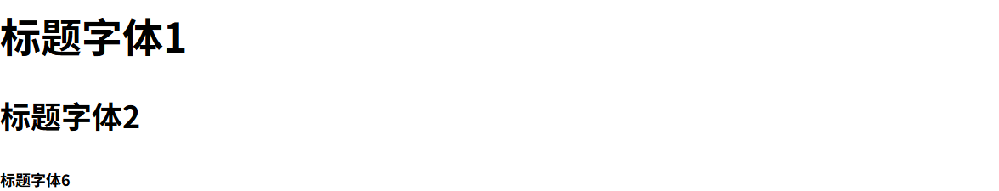
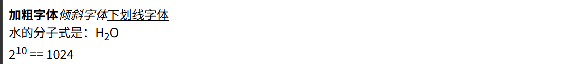
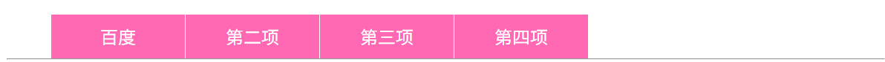
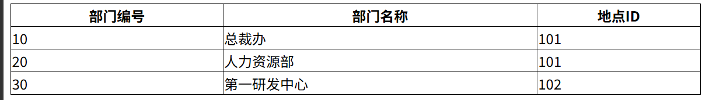
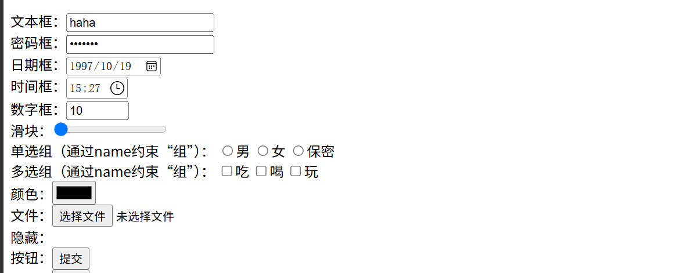

# Node

1. 安装node

2. 在node的根目录下建立两个文件夹`node_global` `node_cache`

3. 执行命令

   ```shell
   npm config set prefix "C:\Program Files\nodejs\node_global"
   npm config set cache "C:\Program Files\nodejs\node_cache"
   ```

4. 配置环境变量

   ```shell
   # 加入
   C:\Program Files\nodejs\node_global  # 这个是自己建的文件夹
   C:\Program Files\nodejs # nodejs
   ```

5. 在powershell里输入`Set-ExecutionPolicy RemoteSigned -Scope CurrentUser`(否则powershell不能用npm)

# 搭建&启动VUE3

## 构建一个VUE项目

执行

```shell
npm create vite@latest
```

根据提示完成即可

```shell
PS D:\03-java\proj_10_19> npm create vite@latest
Need to install the following packages:
create-vite@9.2.1
Ok to proceed? (y) y
> npx
> create-vite
│
◇  Project name:
│  proj_1019
│
◇  Select a framework:
│  Vue
│
◇  Select a variant:
│  TypeScript
│
◇  Install with npm and start now?
│  Yes
│
◇  Scaffolding project in D:\neu\03-java\proj_10_19\proj_1019...
│
◇  Installing dependencies with npm...

added 48 packages, and audited 49 packages in 2m

9 packages are looking for funding
  run `npm fund` for details

found 0 vulnerabilities
│
◇  Starting dev server...

> proj_1019@0.0.0 dev
> vite


  VITE v8.3.4  ready in 358 ms

  ➜  Local:   http://localhost:5173/
  ➜  Network: use --host to expose
  ➜  press h + enter to show help
```

完成之后，vue会自动开始运行，此时就可以通过浏览器浏览这个页面

关闭之后，再次需要启动时：

1. 进入项目目录

2. 执行

   ```shell
   npm run dev
   ```

   


## VUE的项目目录结构

```shell

```


## 语法规则

在一个vue文件里，存在三块内容

```vue
<script setup lang="ts">
    //.... 写逻辑
</script>

<template>
	<!--.... 写页面 -->
</template>

<style lang="css" scoped>
    /*.... 美化页面*/
</style>
```


### TypeScript


### HTML

html中的标签，类似于其他语言中的关键字，每一个标签对应一种页面里的样式，不过大部分标签都可以被划分到<div>和<span>这两类下；

#### \<div\>和\<span\>（块 和 行内）

div是典型的块，一个div一定会占据一整行

span是典型的行内，一个span会根据自身内容的长度决定占据的位置

**一行只能放下一个块，却可能放得下很多 行内**

#### \<h1\> 标题 (块)

h1~h6，分别对应不同大小的标题

```html
<h1>容器标记</h1>
<h2>标题字体2</h2>
<h6>标题字体6</h6>
```




#### div 块 （块）

```html
<div>这是一个块元素</div>
```


#### span 行内 (行内)

```html
<span>这是一个行内元素</span>
```


#### \<b\> \<i\> \<u\> \<sub\> \<sup\>（行内）

```html
<b>加粗字体</b>
<i>倾斜字体</i>
<u>下划线字体</u>
<div>水的分子式是：H<sub>2</sub>O</div>
<div>2<sup>10</sup> == 1024</div>
```




#### \<ul\> \<li\> \<a\> 列表 (块)

无序列表，其中`<ul>`是列表，`<li>`是列表项，`<a>`是超链接

```html
  <ul>
    <li class="list">
      <a href="https://www.baidu.com">百度</a>
    </li>
    <li class="list">
      <a href="#">第二项</a> <!--"#"是空锚点，锚定当前页面的顶端-->
    </li>
    <li class="list">
      <a href="#">第三项</a>
    </li>
    <li class="list">
      <a href="#">第四项</a>
    </li>
  </ul>
```




#### \<table\> \<thread\> \<tr\> \<td\> \<tbody\> 

`<table>` `<thread>` `<tr>` `<tbody>`是 块

`<td>`是 行内

```html
<table> <!--表-->
    <thead>  <!--表头-->
      <tr>  <!-- 一行，同时请注意表头内只允许包含-->
        <th>部门编号</th> <!--单元格-->
        <th>部门名称</th>
        <th>地点ID</th>
      </tr>
    </thead>
    <tbody> <!--表格体-->
      <tr>
        <td>10</td>
        <td>总裁办</td>
        <td>101</td>
      </tr>
      <tr>
        <td>20</td>
        <td>人力资源部</td>
        <td>101</td>
      </tr>
      <tr>
        <td>30</td>
        <td>第一研发中心</td>
        <td>102</td>
      </tr>
    </tbody>
  </table>
```




#### \<form\> （块）

`<form>`是 HTML 中用于收集用户输入并提交数据的容器标签，主要作用包括：
* 数据采集：包裹各种输入控件（如文本框、复选框、下拉菜单、按钮等），统一管理用户填写的信息。
* 数据提交：通过 action 属性指定数据发送到的服务器地址，通过 method 属性指定 HTTP 请求方式（GET 或 POST）。
* 表单验证：配合 HTML5 内置验证属性（如 required、pattern、minlength 等），在提交前对用户输入进行初步校验。
* 编码与传输：通过 enctype 属性控制数据的编码方式（如上传文件时必须设为 multipart/form-data）。
* 重置与提交：提供默认的提交按钮（type="submit"）和重置按钮（type="reset"），方便用户操作。


#### \<input\> （行内）

通过设置type，这个标签可以作为：

1. 输入框          `type="text"`
2. 密码框          `type="password"`
3. 日期框          `type="date"`
4. 时间框          `type="time"`
5. 数字框          `type="number"`
6. 滑块              `type="range"`
7. 单选组          `type="radio"`
8. 多选组         `type="checkbox"`
9. 颜色选择框  `type="color"`
10. 文件选择框  `type="file"`
11. 隐藏的框     `type="hidden"`
12. 按钮            `type="button"`

```html
<div>
    文本框：<input type="text" value="haha" readonly>
</div>
<div>
    密码框：<input type="password" placeholder="请输入密码">
</div>
<div>
    日期框：<input type="date" value="1997-10-19" >
</div>
<div>
    时间框：<input type="time" value="15:27">
</div>
<div>
    数字框：<input type="number" value="10" max="100" min="0" step="10">
</div>
<div>
    滑块：<input type="range" value="0" max="100" min="0" step="10">
</div>
<div>
    单选组（通过name约束“组”）：
      <input type="radio" name="sex" value="1">男
      <input type="radio" name="sex" value="2">女
      <input type="radio" name="sex" value="3">保密
</div>
<div>
    多选组（通过name约束“组”）：
      <input type="checkbox" name="fav" value="1">吃
      <input type="checkbox" name="fav" value="2">喝
      <input type="checkbox" name="fav" value="3">玩
</div>
<div>
    颜色：<input type="color">
</div>
<div>
    文件：<input type="file">
</div>
<div>
    隐藏：<input type="hidden">  <!-- 看不见的text -->
</div>
<div>
    按钮：<input type="button" value="提交">
</div>
```




#### \<button\> (行内)

另一种实现按钮的方法

```html
<div>
    按钮：<button type="button">提交</button>
</div>
```


#### \<select\> \<option\> 下拉表 (行内)

```html
 <div>
    下拉列表：
      <select>
        <option value="1">沈阳</option>
        <option value="2">大连</option>
        <option value="3">鞍山</option>
        <option value="4">抚顺</option>
      </select>
 </div>
```


#### \<textarea\> 文本框（行内）

```html
<div>
    文本区域：<textarea cols="20" rows="5">111aaaaa</textarea>
</div>
```


### CSS

如果说html决定了“页面上有什么”

CSS则决定“页面上的东西长什么样”

#### id

在html中可以给一个标签添加一个id，id必须是全局唯一的

```html
<div>这是<span id="sp1">一个</span>块元素</div>
<div id="div1">演示“传统盒子模式”</div>
```

可以通过id设置标签的样式：

````css
#div1{  			/*要使用 # + id */
    padding: 10px;   /*内间距：内容和边框的距离 */
    padding-top: 50px;
    border: 3px solid #FF0000; /* 边框 */
    margin: 8px;   /*外边距：边框距离外部其他内容的距离 */
    width: 500px;
    height: 100px;
    box-sizing: border-box;  /*基于边框border设置宽高，默认基于内容设置宽高 */
}
#sp1{
    color: aqua;   /* 文字颜色 */
    font-weight: bold;  /* 文字加粗 */
    font-size: 24px;  /* 文字的字号  控制文本大小 */
}
````


#### class

可以给一个标签添加一个class，**class是可以重复的**

```html
<ul>
    <li class="list">
      <a href="https://www.baidu.com">百度</a>
    </li>
    <li class="list">
      <a href="#">第二项</a>
    </li>
    <li class="list">
      <a href="#">第三项</a>
    </li>
    <li class="list">
      <a href="#">第四项</a>
    </li>
</ul>
```

然后可以在css中，使用class设置对应标签的样式

```css
.list{
  float: left;   /* 改变li的布局方式为水平方向 */
  width: 120px;
  height: 40px;  /* 整体高度40px */
  line-height: 40px; /* 行高40px 只有一行文本，自动垂直居中 */
  list-style: none; /* 去掉列表项默认的圆点 */
  
  border-right: 1px solid #FFF; /* 边框 */
  text-align: center; /* 容器中的文本水平居中 */
}
/* 使用了list样式的标记内的<a>标记 */
.list a{
  text-decoration: none; /* none无标记线   line-through删除线   underline下划线 */
  color: #FFF;
  background-color: hotpink; /* 背景颜色 */
  display: block;
}

/* 伪类：hover悬停（大部分容器）   active响应（<a>） */ 
.list a:hover{
  color: hotpink;
  background-color: #e3e3e3;
}
.list a:active{
  font-weight: bold;
  background-color: #A3A3A3;
}
```


## 编写一个页面


## 

